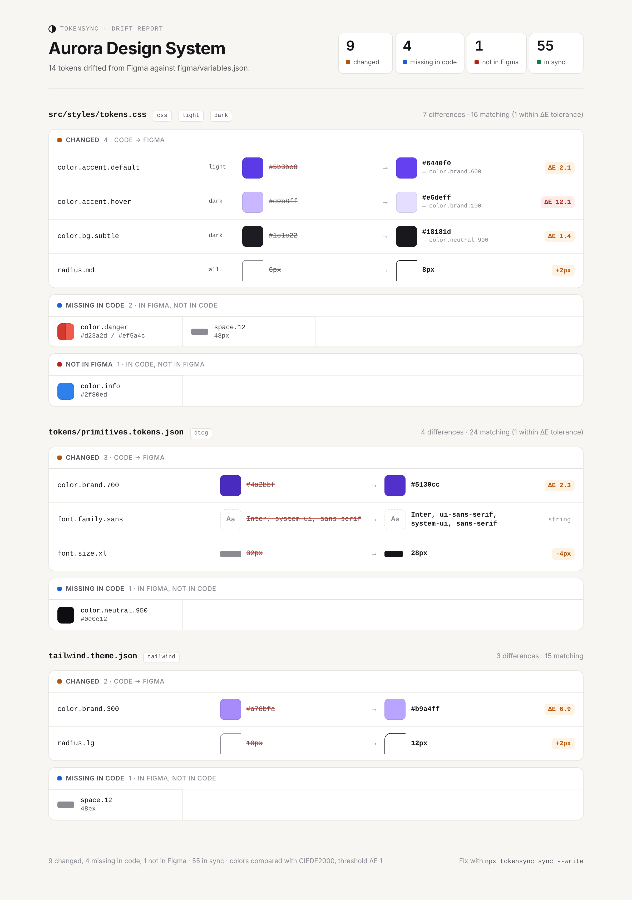
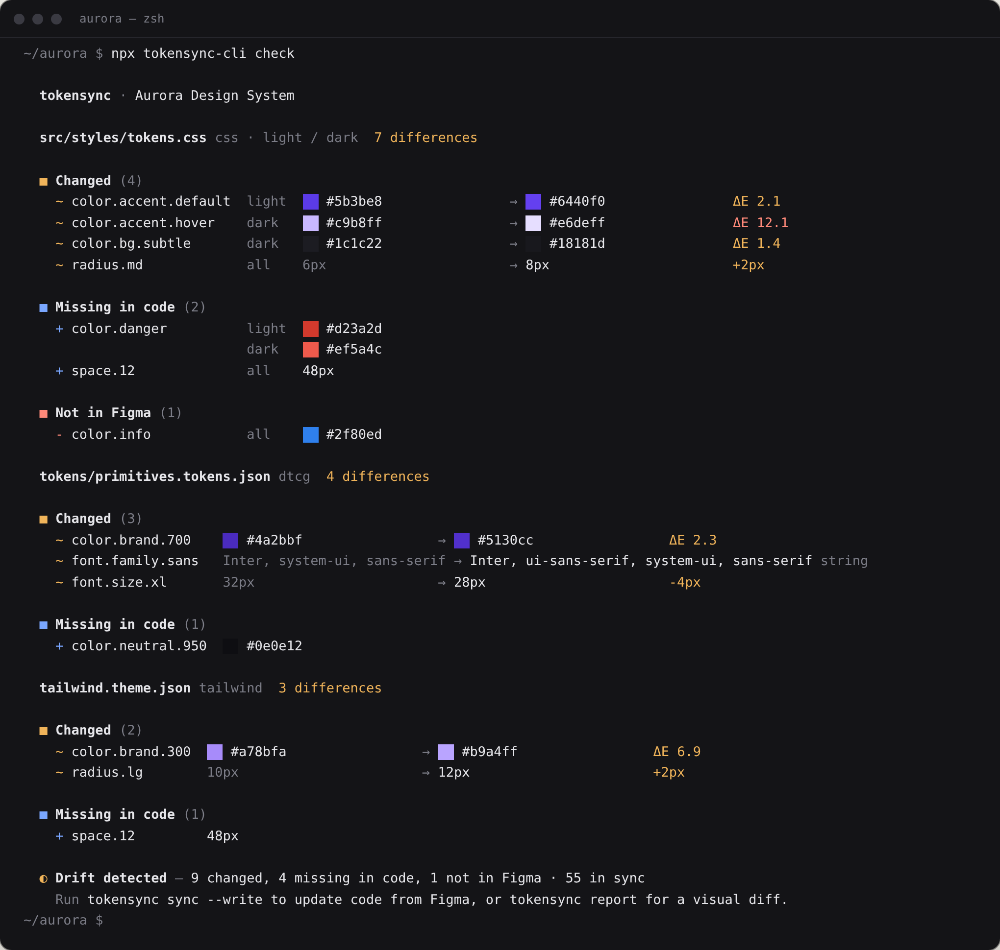
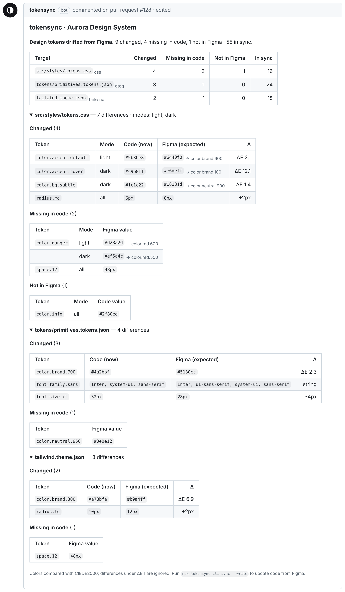
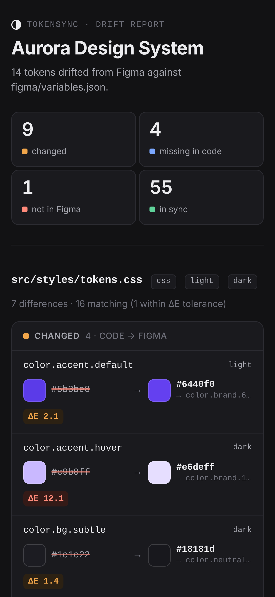

# tokensync

**Catch design-token drift before it ships.**

[](https://github.com/mauriciomsouza/tokensync/actions/workflows/ci.yml)
[](LICENSE)


**[Live demo →](https://mauriciomsouza.github.io/tokensync/)** &nbsp;·&nbsp; [Example report](https://mauriciomsouza.github.io/tokensync/report/) &nbsp;·&nbsp; [How this repo is built](#how-this-repo-is-built)



A designer changes a color in Figma. Nobody updates the CSS. A few months later the product has two sources of truth and every review starts with "which hex is right?"

tokensync compares **Figma variables** with the **tokens in your code** (CSS custom properties, W3C design tokens, or a Tailwind theme), shows what drifted per mode with perceptual color diffs, and can rewrite the code to match, touching only what changed.

## Quick start

### CLI

```bash
npm install --save-dev tokensync

# compare against an exported Figma Variables JSON
npx tokensync check --figma ./figma-variables.json

# …or fetch live (Figma Enterprise plans, token needs file_variables:read)
FIGMA_TOKEN=… npx tokensync check --file-key AbC123xyz
```

Minimal `tokensync.config.json`:

```json
{
  "project": "Acme UI",
  "figma": { "file": "figma/variables.json" },
  "targets": [
    { "format": "css", "path": "src/tokens.css", "modes": { "light": ":root", "dark": "[data-theme=\"dark\"]" } }
  ]
}
```

Then:

```bash
npx tokensync check              # exit 1 on drift: put it in CI
npx tokensync report             # writes tokensync-report.html
npx tokensync sync               # preview the changes as a diff
npx tokensync sync --write       # apply them
```

### GitHub Action

```yaml
# .github/workflows/tokens.yml
on:
  pull_request:
  schedule: [{ cron: '17 9 * * 1-5' }]
permissions:
  contents: write
  pull-requests: write
jobs:
  tokens:
    runs-on: ubuntu-latest
    steps:
      - uses: actions/checkout@v4
      - uses: mauriciomsouza/tokensync@v0
        with:
          figma-file-key: ${{ vars.FIGMA_FILE_KEY }}
          figma-token: ${{ secrets.FIGMA_TOKEN }}
          fail-on-drift: ${{ github.event_name == 'pull_request' }}
          sync-pr: ${{ github.event_name == 'schedule' }}
```

On pull requests it keeps **one** comment up to date with the drift report and fails the check. On the schedule it opens (or updates) a "Sync design tokens from Figma" pull request. A complete, commented example is in [`.github/workflows/example-usage.yml`](.github/workflows/example-usage.yml).

<details>
<summary>All Action inputs and outputs</summary>

| Input               | Default                 |                                                                           |
| :------------------ | :---------------------- | :------------------------------------------------------------------------ |
| `config`            | `tokensync.config.json` | Config path, relative to `working-directory`                              |
| `working-directory` | `.`                     |                                                                           |
| `figma-file-key`    |                         | Fetch live; otherwise uses `figma.file` / `figma.fileKey` from the config |
| `figma-token`       |                         | Pass from a secret. Masked, never logged                                  |
| `threshold`         |                         | Override the ΔE threshold                                                 |
| `comment`           | `true`                  | Sticky PR comment                                                         |
| `fail-on-drift`     | `true`                  | Fail the job when drift is found                                          |
| `sync-pr`           | `false`                 | Run `sync --write` and open/update a PR (not on `pull_request` events)    |
| `sync-branch`       | `tokensync/sync`        |                                                                           |
| `prune`             | `false`                 | With `sync-pr`, also remove tokens not in Figma                           |
| `version`           | `latest`                | tokensync version to run                                                  |

Outputs: `drift`, `changed`, `added`, `removed`, `report-path`, `sync-pr-url`. The HTML report is uploaded as the `tokensync-report` artifact and the Markdown is added to the job summary.

</details>

## Example output

From the fictional [Aurora](examples/aurora) design system in this repo (`npm run example`):



<table>
<tr>
<td width="58%"></td>
<td></td>
</tr>
<tr><td align="center"><sub>PR comment</sub></td><td align="center"><sub>Report, mobile + dark</sub></td></tr>
</table>

And `sync` previews a minimal diff: comments, units and key order stay as they were.

```diff
--- a/src/styles/tokens.css
+++ b/src/styles/tokens.css
@@ -17,5 +17,5 @@

   /* Accent */
-  --color-accent-default: #5b3be8;
+  --color-accent-default: #6440f0;
   --color-accent-hover: #5130cc;

@@ -26,4 +26,5 @@

   --color-focus-ring: rgb(100 64 240 / 0.4);
+  --color-danger: #d23a2d;

   /* Spacing */
```

In `tailwind.theme.json`, `"lg": "0.625rem"` becomes `"0.75rem"`. It stays in rem because the file uses rem.

## How it works

```
 Figma Variables JSON                     code tokens
 (REST API or export)                     tokens.css · tokens.json · theme.json
        │                                          │
        ▼                                          ▼
 ┌──────────────────┐                    ┌──────────────────┐
 │ read + normalize │                    │ adapter.read     │
 │ modes, aliases,  │                    │ selectors/media, │
 │ RGBA→hex, FLOAT  │                    │ var() / {ref}    │
 │ Color/Brand/500  │                    │ --color-brand-500│
 │  → color.brand.500                    │  → color.brand.500
 └────────┬─────────┘                    └────────┬─────────┘
          └──────────────┐          ┌─────────────┘
                         ▼          ▼
                   ┌──────────────────────┐
                   │ diff, per mode        │
                   │ changed/added/removed │
                   │ colors: ΔE 2000 ≤ t   │
                   └───┬──────────────┬────┘
                       ▼              ▼
          ┌────────────────────┐  ┌────────────────────────┐
          │ report             │  │ sync                   │
          │ terminal · JSON ·  │  │ adapter.write: minimal │
          │ Markdown · HTML    │  │ edits, dry run unless  │
          └────────────────────┘  │ --write                │
                                  └────────────────────────┘
```

- **Names.** Every source is normalized to kebab-case segments. Tokens _match_ on the key (`color-brand-500`) and are _shown_ by the dot name (`color.brand.500`). `rename` rules, collection prefixes and a CSS `prefix` cover the rest.
- **Modes.** Multi-mode collections (Light/Dark) produce one value per mode; single-mode collections (primitives) apply to every mode. A CSS target maps each mode to a selector or at-rule; DTCG can use one file per mode.
- **Aliases.** `VARIABLE_ALIAS` chains are resolved across collections, per mode. Values are compared resolved, and `sync` writes references back (`var(--color-brand-600)`, `{color.brand.600}`) when the target has the referenced token.
- **Colors.** Compared in CIELAB with CIEDE2000. Below `threshold` (default `1`, about a just-noticeable difference) counts as in sync and is reported as "within tolerance". Alpha is compared separately.
- **The engine is pure.** `check()` and `sync()` take data and return data. The CLI, the Action and the [browser playground](https://mauriciomsouza.github.io/tokensync/) run the same code.

## Config reference

`tokensync.config.json` (or `.ts` with `defineConfig`, Node 22.18+). Add `"$schema": "./node_modules/tokensync/tokensync.schema.json"` for autocompletion.

| Key                   | Type                             | Default           | Description                                                                                        |
| :-------------------- | :------------------------------- | :---------------- | :------------------------------------------------------------------------------------------------- |
| `project`             | string                           | `"Design tokens"` | Name in reports                                                                                    |
| `figma.file`          | string                           |                   | Exported Variables JSON, relative to the config                                                    |
| `figma.fileKey`       | string                           |                   | Fetch live with `FIGMA_TOKEN`                                                                      |
| `figma.modes`         | `{ [figmaMode]: name }`          |                   | Rename modes, e.g. `{ "Mode 1": "light" }`                                                         |
| `figma.collections`   | `{ [name]: { prefix?, skip? } }` |                   | Prefix a collection's tokens, or skip it                                                           |
| `figma.unitless`      | globs                            |                   | FLOAT variables that are numbers, not px (weights, opacity and z-index are detected automatically) |
| `figma.includeHidden` | boolean                          | `false`           | Include variables hidden from publishing                                                           |
| `threshold`           | number                           | `1`               | CIEDE2000 distance treated as equal                                                                |
| `rename`              | `{ match, replace }[]`           |                   | Regex renames on Figma dot names, in order                                                         |
| `include` / `exclude` | globs                            |                   | Scope for every target. `*` = one segment, `**` = any depth                                        |
| `targets[]`           |                                  |                   | One entry per code file (or set of files), below                                                   |

| Target                     | Keys                                                                                                                                                  |
| :------------------------- | :---------------------------------------------------------------------------------------------------------------------------------------------------- |
| `{ "format": "css" }`      | `path`, `prefix?`, `modes?` (`{ mode: ":root" \| ".dark" \| "@media (prefers-color-scheme: dark)" }`, base first), `remBase?`, `include?`, `exclude?` |
| `{ "format": "dtcg" }`     | `path` (string, or `{ mode: path }`), `mode?`, `include?`, `exclude?`                                                                                 |
| `{ "format": "tailwind" }` | `path`, `mode?`, `groups?` (theme key → token prefix), `remBase?`, `include?`, `exclude?`                                                             |

### CLI

| Command / flag                        |                                                                        |
| :------------------------------------ | :--------------------------------------------------------------------- |
| `check`                               | Compare; exit `0` in sync, `1` drift, `2` usage/config error           |
| `report [-o file]`                    | HTML report (default `tokensync-report.html`)                          |
| `sync [--write] [--prune]`            | Dry-run diff; `--write` applies; `--prune` removes tokens not in Figma |
| `--figma <file>` / `--file-key <key>` | Figma source (overrides config)                                        |
| `-c, --config <path>`                 | Config path                                                            |
| `--threshold <ΔE>`                    | Override threshold                                                     |
| `--json`, `--markdown`, `-o`          | `check` output format, optionally written to a file                    |
| `--no-fail`, `--no-color`             |                                                                        |

## Supported formats

| Format                       | Read | Write | Modes                          | Aliases                            | Notes                                                                         |
| :--------------------------- | :--: | :---: | :----------------------------- | :--------------------------------- | :---------------------------------------------------------------------------- |
| Figma Variables (REST shape) |  ✓   |   —   | Per collection                 | `VARIABLE_ALIAS`, cross-collection | COLOR, FLOAT, STRING, BOOLEAN                                                 |
| CSS custom properties        |  ✓   |   ✓   | Selector or at-rule per mode   | `var(--x)`                         | Keeps comments, color syntax (hex/rgb/hsl) and units (px/rem)                 |
| W3C Design Tokens (DTCG)     |  ✓   |   ✓   | One file, or one file per mode | `{group.token}`                    | String values and 2025-draft `{ colorSpace, components }` / `{ value, unit }` |
| Tailwind theme JSON          |  ✓   |   ✓   | One mode per file              | —                                  | `theme`, `theme.extend` or bare; `DEFAULT` keys; configurable groups          |

Not yet: composite tokens (typography, shadow), SCSS/JS theme files, iOS/Android outputs. See the roadmap.

## How this repo is built

tokensync is built by its author working with a small team of AI agents, each with one job and its own brief: **Orchestrator, Business, Design, Dev, QA, Infra, Release and Marketing**. The rule that matters most: _the agent that implements a change never approves it._ QA reviews against the inviolable rules in [`CLAUDE.md`](CLAUDE.md) (never write without `--write`, never log the Figma token, fictional fixtures, deterministic output), and every visual change ships with screenshots rendered from real output.

- [`docs/AGENT_TEAM.md`](docs/AGENT_TEAM.md): roles, iteration flow, decisions reserved for the human owner
- [`.claude/agents/`](.claude/agents): the role prompts
- [`docs/PLAN.md`](docs/PLAN.md) phases and gates · [`docs/STACK.md`](docs/STACK.md) choices and why · [`docs/design/DESIGN_SPEC.md`](docs/design/DESIGN_SPEC.md) the "Proof" visual system · [`docs/business/BUSINESS.md`](docs/business/BUSINESS.md) positioning · [`docs/marketing/LAUNCH.md`](docs/marketing/LAUNCH.md) launch drafts

## Roadmap

- [x] Figma Variables with modes and aliases; CSS, DTCG, Tailwind adapters
- [x] ΔE 2000 comparison, terminal/JSON/Markdown/HTML output, minimal `sync --write`
- [x] GitHub Action with sticky comment and sync PR; browser playground
- [ ] Publish `0.1.0` to npm and tag the Action (`v0`)
- [ ] Composite tokens: typography and shadows
- [ ] Adapter plugins (SCSS maps, JS/TS theme objects)
- [ ] `tokensync init` to generate a config from an existing repo
- [ ] Multiple Figma files and library variables

## Development

```bash
npm ci
npm run verify        # typecheck, lint, test, build, site build
npm run preview:site  # demo under http://localhost:4173/tokensync/
npm run render        # regenerate docs/design/screens (needs Chrome)
```

See [CONTRIBUTING.md](CONTRIBUTING.md). All example data is fictional.

## License

[MIT](LICENSE) © Mauricio Souza
